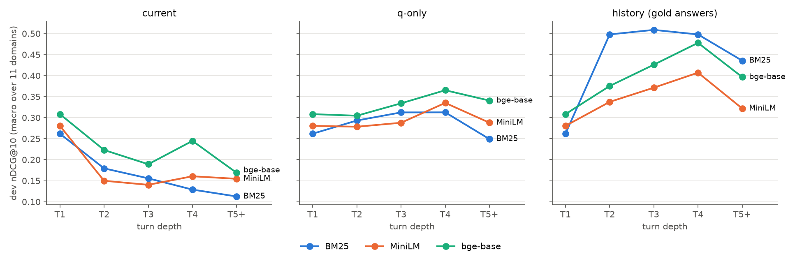

# SemEval-2027 RETECO: finding documents in multi-turn conversations

UCU "Artificial Intelligence" course project on [SemEval-2027 RETECO](https://github.com/DataScienceUIBK/RETECO),
**Track 2** (RECOR data).

A user asks a series of related questions. For every question (a *turn*) we must find the documents that help to
answer it. The hard part: later questions depend on earlier ones. *"Is it really that easy for dirt to get in if
there's oil on those parts?"* only makes sense if you know the conversation was about lubricating drone motors.

This repository contains the midterm work: a BM25 baseline, two pre-trained dense retrievers (MiniLM and bge-base)
with a FAISS index, an evaluation that matches the official scorer, experiments on how to use the conversation
history, and a first error analysis.

## Team

| Name | Part |
|---|---|
| Daryna Horetska | data loading, data exploration (EDA), encoding the documents, FAISS search |
| Nazar Mykhailyshchuk | query building, evaluation and run files, BM25 baseline, check against the official scorer |
| Daryna Antoniuk | dense retrieval runs, grid searches, context-length study, comparison tables, error analysis, README |

Mentors: Marta Sumyk, Oleksandr Kosovan.

## The data

| | |
|---|---|
| domains | 11: biology, drones, earth_science, economics, hardware, law, medicalsciences, politics, psychology, robotics, sustainable_living |
| documents | 507,141 (each domain has its own collection, shared by train and dev) |
| conversations / turns | 707 / 2,971 (train 2,113, dev 858) |
| turns by depth T1 / T2 / T3 / T4 / T5+ | train 496 / 496 / 496 / 290 / 335, dev 211 / 211 / 211 / 121 / 104 |

Each turn has a list of relevant ("gold") documents. A turn id looks like `ex_3025_turn_2` and is unique only inside
its domain. Data exploration: [`results/eda/`](results/eda/), [turns per depth](results/figures/turn_depth.png),
[long queries per depth](results/figures/query_length.png).

## What you need

- **[uv](https://docs.astral.sh/uv/)**, which installs Python 3.12 and all packages for you.
  Windows: `powershell -c "irm https://astral.sh/uv/install.ps1 | iex"`. macOS/Linux: see the uv website.
- **git**.
- **About 2 GB of disk space**: the data is ~0.3 GB, the document vectors ~1.2 GB.
- **A Hugging Face account in the `reteco-team` organisation** with a *Read* token, to download the shared
  document vectors. Only needed for the dense (MiniLM, bge-base) parts.
- **A GPU is optional.** With an NVIDIA GPU (Windows gets the CUDA build of torch automatically) or an Apple Silicon
  Mac, the dense steps take minutes. On a CPU everything still runs, just slower. BM25 runs on the CPU anyway.
- On macOS, torch and faiss in one process can crash. Run with
  `OMP_NUM_THREADS=1 KMP_DUPLICATE_LIB_OK=TRUE TOKENIZERS_PARALLELISM=false`.

## Setup

```bash
git clone https://github.com/partum55/SemEval-RETECO.git
cd SemEval-RETECO
uv sync
uv run hf download DataScience-UIBK/RETECO-SemEval2027 --repo-type dataset --include "track2_recor/*" --local-dir data/reteco
uv run hf auth login
uv run hf download reteco-team/reteco-embeddings --repo-type dataset --local-dir data/emb
uv run pytest
```

`uv run pytest` runs 38 tests; the ones that need the data or the vectors are skipped if those are not downloaded.
The document vectors were made once with `scripts/encode_corpus.py` and shared, so you don't have to encode
507k documents yourself.

## How to run

Run everything from the repo root. A single dense run, for example:

```bash
uv run python scripts/run_dense.py --model bge-base --variants current qonly history
```

It prints the scores and saves the results. To reproduce every number in this README, run these in order
(times for a laptop with a GTX 1650):

```bash
uv run python scripts/eda.py                 # data statistics and two EDA figures
uv run python scripts/bm25_baseline.py       # ~4 min: BM25 with the official settings
uv run python scripts/bm25_grid.py           # ~1 h on CPU: BM25 settings search

uv run python scripts/run_dense.py --model minilm   --variants current qonly history     # dense baselines
uv run python scripts/run_dense.py --model bge-base --variants current qonly history
uv run python scripts/run_dense.py --model minilm   --variants history --rebuild         # context-length study
uv run python scripts/run_dense.py --model minilm   --variants history --recent-first
uv run python scripts/run_dense.py --model minilm   --variants history --query-max-len 512
uv run python scripts/run_dense.py --model bge-base --variants history --rebuild
uv run python scripts/run_dense.py --model bge-base --variants history --recent-first

uv run python scripts/dense_grid.py --model minilm      # ~5 min: query settings search
uv run python scripts/dense_grid.py --model bge-base    # ~15 min

uv run python scripts/sample_errors.py       # picks 30 dev turns for the error analysis
uv run python scripts/make_tables.py         # all tables and figures; also updates the table in this README
uv run python scripts/check_official.py      # optional, ~10 min: checks every run with the official tools
```

Most scripts have a short note at the top saying what they do and what they write. Lint with `uv run ruff check`.

## Project structure

```
SemEval-RETECO/
├── src/semeval_reteco/      the library, one file per job
│   ├── config.py            paths, the 11 domains, the splits
│   ├── data.py              reads documents, conversation turns and relevance labels
│   ├── queries.py           builds the query text for a turn (current / q-only / history)
│   ├── bm25.py              BM25 search, same settings as the official baseline
│   ├── embeddings.py        dense models: encode documents and queries, FAISS search
│   ├── evaluate.py          metrics per turn, averages, run files, metrics files
│   └── stats.py             bootstrap test: "is A really better than B?"
├── scripts/                 the steps you run (see "How to run")
├── tests/                   38 tests (pytest)
├── results/                 everything here is made by the scripts
│   ├── tables/              main results, by depth, by domain, comparisons, context length, error types
│   ├── figures/             plots used in this README and the slides
│   ├── metrics/             the score of every turn for every system (all tables are built from these)
│   ├── bm25/                BM25 baseline and BM25 settings search
│   ├── dense_grid/          dense query settings search
│   ├── error_analysis/      the 30 sampled turns and their error labels
│   ├── eda/                 data statistics
│   └── newest_first/        first newest-first experiment (MiniLM only)
├── data/                    downloaded data and vectors (not in git)
├── pyproject.toml, uv.lock  packages and their exact versions
└── README.md
```

Run files (the ranked lists, `results/runs/`) are not in git; the scripts recreate them.

## The pipeline

```
data (documents, conversations, relevance labels)
   │
   ▼
query text for each turn          the same text for every retriever
   │
   ├──► BM25 (keyword matching)
   └──► dense model: query → vector → FAISS finds the closest document vectors
   │
   ▼
top 100 documents per turn        saved in the official run format
   │
   ▼
scores per turn → averages per domain → average over the 11 domains → tables, tests, figures
```

1. **Load the data** for a domain.
2. **Build the query.** Three versions, for every retriever:
   - **current**: only the current question;
   - **q-only**: the question plus the earlier *questions* of the conversation;
   - **history**: the question plus the earlier questions **and their answers**. This is how the official baseline
     uses the history, but these answers are the dataset's *gold* answers, which a real system would not have.
     So q-only is the realistic setting, and we always report both.
3. **Search.** Each retriever returns the 100 best documents.
4. **Score** every turn and average.

## Baseline: BM25

BM25 scores a document by the query words it contains, giving more weight to rare words. We use the organizers'
own settings (k1 = 0.9, b = 0.4, the same tokenizer and stemmer) and reproduce their numbers: dev 0.1819 vs the
official 0.1827 for the current turn, and 0.4377 vs 0.4379 with history. The tiny difference comes from how equal
scores are ordered.

## Models

| Model | Size | Reads up to | Why we use it |
|---|---|---|---|
| all-MiniLM-L6-v2 | 22M parameters | 256 tokens | small, fast, a standard first dense model |
| bge-base-en-v1.5 | 110M parameters | 512 tokens | strong retrieval model for its size, made for search queries, reads longer queries |

Both are used as they are, without training ("unadapted"), as the proposal planned for the midterm. Documents were
encoded once; at search time only the query is encoded and FAISS returns the closest documents.

## How we measure

- **nDCG@10** is the official metric: are the relevant documents near the top of the first 10?
- Extra metrics: **MAP@10**, **Recall@10**, **Recall@100** (how many relevant documents are anywhere in the top
  100; a re-ranker can only work with those) and **MRR** (how early the first relevant document appears).
- **Macro average**: average each domain first, then average the 11 domains, so each domain counts the same.
  This is the leaderboard rule.
- Results are also split **by turn depth** (T1 … T5+) and **by domain**.
- **Settings are chosen on train and reported on dev**, so the dev numbers are not tuned to dev.
- "A is better than B" is checked with a **paired bootstrap over whole conversations** (95% confidence intervals,
  CI). If the CI includes 0, we call it a tie.
- `scripts/check_official.py` runs the official format checker and scorer on all 330 run files: all are valid and
  the official nDCG@10 matches ours.

## Results

Dev split, macro average over the 11 domains. *Grid-selected* rows appear only where a settings search on train
picked something other than the default.

<!-- main-table -->
| query | retriever | dev nDCG@10 | dev MAP@10 | dev Recall@10 | dev Recall@100 | dev MRR | train nDCG@10 |
|---|---|---|---|---|---|---|---|
| current | BM25 | 0.1819 | 0.1353 | 0.2782 | 0.5551 | 0.1844 | 0.1846 |
| current | BM25, grid-selected | 0.1936 | 0.1472 | 0.2890 | 0.5705 | 0.1967 | 0.1955 |
| current | MiniLM | 0.1837 | 0.1344 | 0.2723 | 0.5934 | 0.2004 | 0.1998 |
| current | bge-base | 0.2353 | 0.1778 | 0.3410 | 0.6612 | 0.2515 | 0.2572 |
| q-only | BM25 | 0.2921 | 0.2273 | 0.4205 | 0.7302 | 0.2944 | 0.2993 |
| q-only | BM25, grid-selected | 0.3015 | 0.2376 | 0.4275 | 0.7390 | 0.3036 | 0.3091 |
| q-only | MiniLM | 0.2913 | 0.2172 | 0.4195 | 0.7574 | 0.3130 | 0.3164 |
| q-only | bge-base | 0.3222 | 0.2410 | 0.4765 | 0.8076 | 0.3271 | 0.3640 |
| history (gold answers) | BM25 | 0.4377 | 0.3610 | 0.5639 | 0.8240 | 0.4613 | 0.4543 |
| history (gold answers) | BM25, grid-selected | 0.4330 | 0.3532 | 0.5647 | 0.8326 | 0.4583 | 0.4573 |
| history (gold answers) | MiniLM | 0.3413 | 0.2583 | 0.4852 | 0.8014 | 0.3598 | 0.3735 |
| history (gold answers) | MiniLM, grid-selected | 0.3474 | 0.2659 | 0.4865 | 0.8069 | 0.3697 | 0.3840 |
| history (gold answers) | bge-base | 0.3862 | 0.3006 | 0.5398 | 0.8542 | 0.3950 | 0.4413 |
| history (gold answers) | bge-base, grid-selected | 0.3874 | 0.3020 | 0.5407 | 0.8526 | 0.3961 | 0.4439 |
<!-- /main-table -->



More: [all tables](results/tables/) (by depth, by domain, comparisons, context length, error types),
[BM25 settings search](results/bm25/grid.md), [dense settings search](results/dense_grid/),
[context-length figure](results/figures/context_length.png).

## Conclusions

1. **The conversation history helps the most.** For bge-base, adding the earlier questions gives +0.087 nDCG@10,
   and adding the gold answers on top another +0.064. For BM25: +0.110 and +0.146. Keeping only the last 1 or 2
   turns was always worse, so even old turns are useful. With history, a query shares about 24 words with its
   gold documents, against about 4 for the question alone (EDA).
2. **Dense vs BM25 depends on the query.** On the question alone bge-base wins by +0.053 (CI above 0); with the
   earlier questions it is a tie (+0.030, CI includes 0); with the gold-answer history BM25 wins by 0.051 (CI
   below 0). A long history is a good bag of words for BM25, while a dense model has to squeeze it into one vector.
   bge-base beats MiniLM in every case (+0.03 to +0.05, CIs above 0).
3. **Dense models find the right documents but rank them badly.** bge-base has more relevant documents in its
   top 100 than BM25 in every row (Recall@100, e.g. 0.808 vs 0.730 with earlier questions, 0.854 vs 0.824 with
   history), even where its nDCG@10 is lower. A re-ranker could move them up; that is the next stage.
4. **Long queries: reading more helps, reordering does not.** MiniLM cuts queries after 256 tokens, which happens
   to almost every history query from turn 4 on. Letting it read 512 tokens helps (+0.024 on turns 4 and 5+, CI
   above 0). Putting the newest turns first, so the oldest are cut instead (the fix planned in the proposal), does
   not help either model (CIs include 0).
5. **Tuning changes little.** Searching over query settings and BM25 settings on train gave no clear gains on dev,
   except a lower b for BM25 on short queries (+0.009 for q-only, CI above 0). The bge-base instruction prefix
   matters: without it, train scores drop by 0.03–0.06.
6. **What still fails.** 106 of 858 dev turns (12%) get nDCG@10 = 0 from all nine systems. In 30 sampled failures
   the most common reasons are *the right page but the wrong passage* (8) and *unclear references* such as
   "those pores" (8), then wrong wording (4), questions that need reasoning (4), topic changes (3) and doubtful
   gold labels (3) ([error types](results/tables/error_types.md)).

## Limitations

- **Gold answers.** The `history` query contains the gold answers of earlier turns. The official docs do not say if
  the hidden test set will include them, so q-only is our realistic number until we know.
- **Small groups of deep turns.** Dev has only 104 turns at depth 5+, and some domains have 1–3 of them. Numbers
  for T4 and T5+ are noisy.
- **Many comparisons.** We report about 20 confidence intervals without correcting for multiple tests, so one of
  them could exclude 0 by chance. Our conclusions rest on the large effects.
- **Cut documents.** MiniLM reads only the first 256 tokens of a document; in drones, hardware, law,
  medicalsciences and politics 22–40% of documents are longer.
- **Top 100 only.** Runs keep 100 documents per turn (the official baseline keeps 1000). This does not change
  nDCG@10 or Recall@100. MRR is computed over these 100.
- **Small error sample.** 30 turns show which kinds of errors exist, not how often each happens.
- **No training yet.** Both dense models are used as they are; adapting them comes after the midterm.

## Next steps

- A **cross-encoder re-ranker** (e.g. bge-reranker) over the top 100 of bge-base, BM25 and a mix of both.
- Find the best way to give the conversation history to the re-ranker.
- **Fine-tune** on the training conversations with hard negatives (wrong documents from our own top 100).
- A larger error analysis with two annotators.

## Data and license

Data: RECOR (Ali et al., Findings of ACL 2026), CC-BY-SA-4.0, via the official RETECO release. Code: MIT license.
